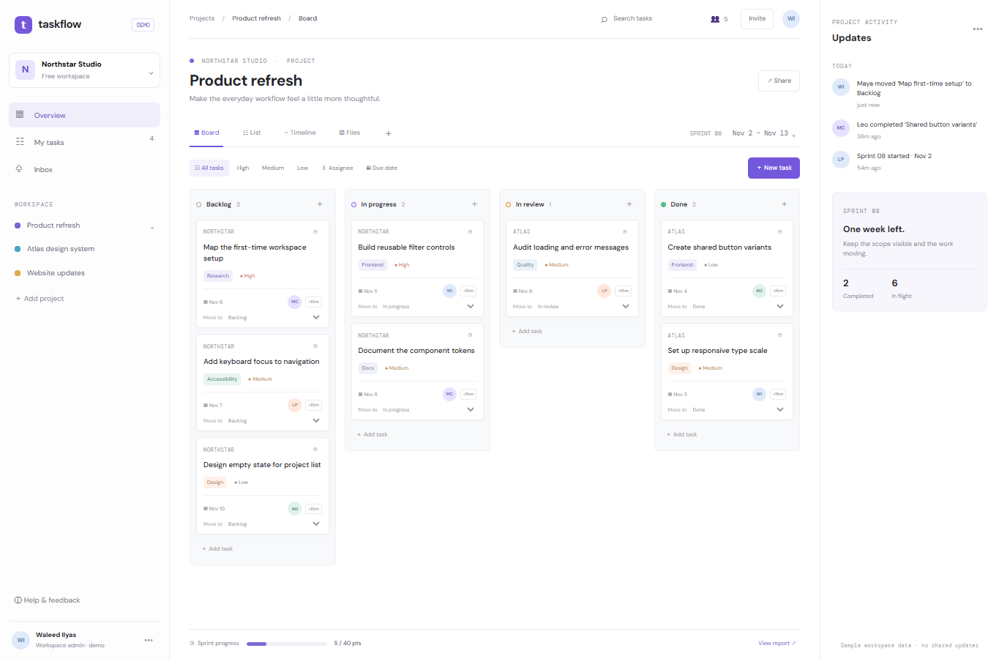

# TaskFlow

A standalone project planning UI concept with an interactive local Kanban board. The team, project, sprint, and activity data are fictional samples and do not represent existing client work.

## Run locally

From the workspace root, run `npm install`, then `npm run dev --workspace=taskflow-pm` and open `http://localhost:3004`. For production, run `npm run build --workspace=taskflow-pm` and `npm run start --workspace=taskflow-pm`.

## Local API

In a second terminal, run `npm run api --workspace=taskflow-pm` to start the Express API at `http://127.0.0.1:4104`. Check `/api/health` and use `/api/tasks` for task reads, creation, and status updates. Data persists in `server/data.json`; records are fictional samples.

## Features

- Responsive project workspace, sprint board, activity panel, and search/priority filters.
- Drag tasks between board lanes or use the accessible status selector.
- Add local tasks, update the activity feed, and add 15-minute time entries.
- Sample sprint progress derived from the current board state.

## Scope

The local Express API supports task creation and status updates using JSON file storage. The remaining board controls are local UI state; there is no account system, hosted collaboration, authorization, or audit log. Team and activity information is sample data. Screenshots and live/source links will be added after review and explicit approval for public publishing.

## Tech stack badges

  

## Screenshots

## Environment variables

`API_PORT` is optional and defaults to `4104`. No external credentials or paid APIs are needed.
